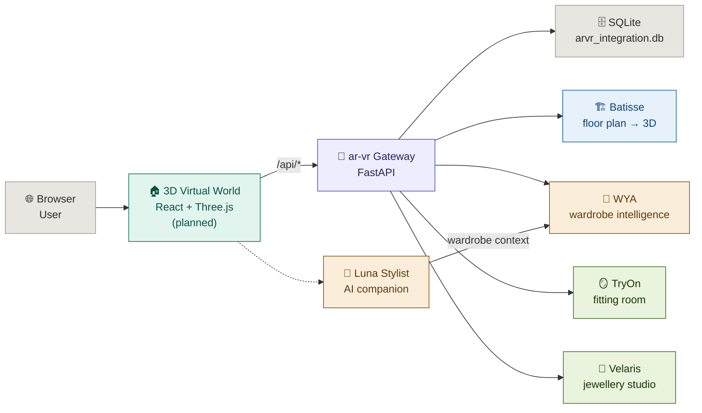

<div align="center">

# ORVYNE — Your Personal Virtual World

**Upload your floor plan. Walk through your home. Open your wardrobe. Try it on. Design the jewellery.**

[](https://github.com/ria0304/ORVYNE)


</div>

ORVYNE is a personalised virtual-world platform: a digital version of your own home that holds your wardrobe, a fitting room, a jewellery studio and an AI stylist. Five independent projects do the work; the `ar-vr/` gateway is the hub that connects them.

> **Read this first — what is real today**
>
> | Works today (as standalone projects) | Not built yet |
> |---|---|
> | Floor plan → 3D dollhouse (Batisse) | The unified 3D walkthrough |
> | Wardrobe AI and outfit scoring (WYA) | Rooms that open the wardrobe, fitting room and boutique |
> | Garment cutouts, mannequin, outfit builder (TryOn) | Saving a complete look (clothing + jewellery) |
> | Jewellery design, CAD, PDF, DXF (Velaris) | One sign-in across all projects |
> | Chat styling over WYA (Luna) | AR / VR |
>
> The `ar-vr` gateway runs, but its health check, Luna route and several adapter calls are broken, and most room/navigation routes are stubs. Details in [Status](#status) and [Known Limitations](#known-limitations).

---

## Contents

- [The Problem](#the-problem)
- [The Solution](#the-solution)
- [Core User Flow](#core-user-flow)
- [The Five Technologies](#the-five-technologies)
- [The Integration Layer](#the-integration-layer-ar-vr)
- [Architecture](#architecture)
- [Tech Stack](#tech-stack)
- [Project Structure](#project-structure)
- [Quick Start](#quick-start)
- [Verify the Gateway](#verify-the-gateway)
- [Common Issues](#common-issues)
- [Environment Variables](#environment-variables-ar-vr)
- [Status](#status)
- [Known Limitations](#known-limitations)
- [Roadmap](#roadmap)
- [License](#license)

---

## The Problem

Online fashion and jewellery shopping happens in disconnected tools, inside generic virtual malls that know nothing about the person using them.

- **Customers** keep their wardrobe in one app, outfit inspiration in another, try-on in a third and custom jewellery in a fourth. None share context, and none feel like *their* space.
- **Builders** of those tools have the opposite problem: each product is useful alone, but nothing ties them into one journey a user can walk through.

## The Solution

Instead of a generic virtual mall, every ORVYNE user gets a personal virtual space.

1. **Create your virtual home.** Upload your real floor plan. Batisse generates a 3D version.
2. **Enter your home.** Walk through your rooms with keyboard and mouse.
3. **Explore your wardrobe.** WYA brings your real wardrobe in and helps you discover outfits.
4. **Try on clothes.** TryOn generates virtual clothing previews.
5. **Design jewellery.** Visit your own jewellery boutique, powered by Velaris.
6. **Get styling help.** Luna Stylist suggests outfit combinations using your wardrobe.

The `ar-vr` backend coordinates all of it through each project's REST API. No code is duplicated and no databases are merged.

## Core User Flow

```
Sign up
   ↓
Upload floor plan (JPG / PNG / PDF)
   ↓
Batisse: plan → walls, rooms, openings → validated geometry → GLB
   ↓
Virtual home: rooms assigned a function (bedroom, study, storage …)
   ↓
 ┌───────────────┬────────────────┬──────────────────┬──────────────────┐
 ↓               ↓                ↓                  ↓
Wardrobe room   Fitting room     Jewellery boutique  Luna Stylist
WYA closet,     TryOn outfit     Velaris text /      Conversational
outfit scoring  previews         sketch / photo →    styling over WYA
                                 design + spec       wardrobe context
   ↓
Complete look (clothing + jewellery)
```

---

## The Five Technologies

| # | Project | Role | What it does |
|---|---|---|---|
| 1 | **Batisse** | Virtual home | Converts uploaded floor plans into 3D house geometry |
| 2 | **WYA** | Wardrobe intelligence | Clothing management, outfit recommendations, colour analysis, personal style |
| 3 | **TryOn** | Virtual fitting room | Previews of how clothing may look on a person |
| 4 | **Velaris** | Jewellery studio | Personalised jewellery designs from creative inspiration |
| 5 | **Luna Stylist** | AI fashion companion | Conversational styling using WYA wardrobe context |

<details>
<summary><b>1 — Batisse: floor plan → 3D home</b></summary>

FastAPI + SQLAlchemy backend with a classical CV pipeline: OpenCV / PyMuPDF preprocessing (resize, deskew, perspective correction), wall / room / opening detection with per-element confidence, Tesseract OCR for room labels and dimensions, and a Shapely geometry builder (shared walls, T-junctions, footprint, validation). Scale is proposed from labels but never auto-applied: the user confirms it with a two-point reference. The frontend is React 19 + `@react-three/fiber` with a dollhouse viewer, 2D plan editor (undo/redo) and 2D↔3D selection sync. Geometry exports to GLB.
</details>

<details>
<summary><b>2 — WYA: wardrobe intelligence</b></summary>

Full-stack fashion AI app: FastAPI backend, React + TypeScript frontend, FashionCLIP embeddings, colour matching, style profiling, outfit generation, gap analysis, weather-aware outfits and a sustainability score. Deployed on AWS (CloudFront + S3 + EC2). Screenshots live in `WYA-Whats-Your-Aesthetic-main/screenshots/`.
</details>

<details>
<summary><b>3 — TryOn: virtual fitting room</b></summary>

Turns any clothing screenshot into a transparent garment cutout, fits it to a 3D mannequin (React Three Fiber), and lets users build, save and compare outfits. An optional local CatVTON pipeline produces photorealistic renders. **The pipeline is image-based: no 3D cloth simulation, no avatar rigging.**
</details>

<details>
<summary><b>4 — Velaris: jewellery studio</b></summary>

Turns text, sketches or inspiration photos into a jeweller-ready spec sheet, parametric CAD views (7 jewellery types), realistic previews, a cost breakdown, a PDF and a 2D DXF. A multi-model OpenRouter fallback chain drives generation; four optional deep learning modules (type, style, gemstone, similarity) fail soft. **Output is 2D: no 3D jewellery meshes.**
</details>

<details>
<summary><b>5 — Luna Stylist: AI fashion companion</b></summary>

Chat interface over WYA's API. Intent classification plus smart replies, with outfit cards and a wardrobe panel synced from the user's WYA account. The server runs on its own port (8001).
</details>

---

## The Integration Layer (`ar-vr/`)

`ar-vr/` is the main code of ORVYNE: a FastAPI service that

- **Gateways** requests to Batisse, WYA, TryOn and Velaris through one API
- **Adapts** each project through a dedicated `httpx` async service class
- **Shares schemas**: `UserReference`, `RoomMetadata`, `ScaleInfo`, `AssetReference`, `RoomAssignment`
- **Reserves a coordination DB**: `arvr_integration.db` with one `integration_metadata` table, created on startup. No route writes to it yet
- **Leaves the originals alone**: each project keeps its own code, API and database

### Integration endpoints

Legend: ✅ delegates to the downstream project · 🟡 stub (returns success, stores nothing) · 🔴 known broken

| | Method | Endpoint | Delegates to / behaviour |
|---|---|---|---|
| 🔴 | `GET` | `/api/health` | Meant to report downstream status; always shows `unreachable` (bad import) |
| ✅ | `POST` | `/api/batisse/upload` | Batisse `POST /api/projects` |
| ✅ | `GET` | `/api/batisse/projects/{id}/geometry` | Batisse validated geometry |
| ✅ | `POST` | `/api/batisse/projects/{id}/geometry/export-glb` | Batisse GLB export |
| 🟡 | `POST` | `/api/batisse/projects/{id}/geometry/scale-reference` | Placeholder, does not call Batisse |
| ✅ | `POST` | `/api/wardrobe/browse` | WYA `GET /api/user/wardrobe` |
| ✅ | `POST` | `/api/wardrobe/outfit-recommendations` | WYA `GET /api/ai/outfit-score` |
| ✅ | `POST` | `/api/tryon/generate` | TryOn `POST /api/tryon` |
| 🟡 | `GET` | `/api/tryon/status` | Hard-coded response, never contacts TryOn |
| ✅ | `POST` | `/api/jewellery/generate-design` | Velaris `POST /api/generate-design` |
| ✅ | `GET` | `/api/jewellery/designs` | Velaris `GET /api/trends` (trend data, not saved designs) |
| 🔴 | `POST` | `/api/luna/chat` | Calls an undefined `WYA_BASE_URL` and the wrong path |
| 🟡 | `POST` | `/api/navigation/set-position/{user_id}` | Echoes the position |
| 🟡 | `POST` | `/api/navigation/set-room/{user_id}/{room_id}` | Echoes the room |
| 🟡 | `GET` | `/api/navigation/get-position/{user_id}` | Always returns the origin |
| 🟡 | `POST` | `/api/room/interact/{user_id}/{room_id}/{action}` | Echoes the action |
| 🟡 | `POST` | `/api/room/door/open/{user_id}/{from_room}/{to_room}` | Echoes the request |
| 🟡 | `POST` | `/api/room/window/toggle/{user_id}/{room_id}` | Echoes the request |
| 🟡 | `POST` | `/api/integrate/assign-room-function` | Echoes the assignment, no persistence |
| 🟡 | `POST` | `/api/integrate/save-look` | Echoes a look id, no persistence |

Room functions: `bedroom`, `living_room`, `kitchen`, `bathroom`, `dining_room`, `storage`, `spare_bedroom`, `study`, `balcony`, `hallway`, `other`.

---

## Architecture



Solid arrows exist in `ar-vr/backend`, though several of those routes are stubs. The unified 3D front end is a scaffold only; see [Known Limitations](#known-limitations).

---

## Tech Stack

| Layer | Technologies |
|---|---|
| **Gateway (`ar-vr/`)** | FastAPI, Uvicorn, Pydantic, `httpx`, SQLAlchemy + SQLite (PostgreSQL via `DATABASE_URL`), `python-dotenv`, CORS allowlist. `slowapi` is listed but not wired |
| **Gateway frontend** | Vite + `three` scaffold (React and `react-router-dom` are imported but not declared in `package.json`) |
| **Project frontends** | React + TypeScript + Vite, Tailwind CSS, Three.js / `@react-three/fiber` / `@react-three/drei` (Batisse, TryOn), Zustand (Batisse) |
| **Project backends** | FastAPI across all five. OpenCV, Shapely, PyMuPDF, Tesseract (Batisse) · FashionCLIP, AWS SageMaker (WYA) · rembg, MediaPipe, CatVTON (TryOn) · OpenRouter fallback chain, PyTorch, ultralytics, CLIP, ReportLab, `ezdxf` (Velaris) |

---

## Project Structure

```
ORVYNE/
├── ar-vr/                  # ★ Integration layer (gateway + scaffold frontend)
│   ├── backend/app/        #   main.py, config.py, database.py, schemas.py, services/
│   ├── frontend/           #   Vite scaffold, does not build yet
│   └── tests/
├── batisse/                # Floor plan → 3D dollhouse
├── WYA-Whats-Your-Aesthetic-main/   # Wardrobe intelligence
├── TryOn-main/             # Virtual fitting room
├── Velaris-From-Inspiration-to-Jewellery-Design-main/   # Jewellery studio
└── luna-stylist-main/      # AI fashion companion
```

Each folder has its own README with project-level detail.

---

## Quick Start

Each project is its own service. Start only what you need, then the gateway.

**Prerequisites:** Python 3.10+, Node.js 18+, and the Tesseract OCR binary (Batisse only).

### 1. Pick a port map

All backends default to port `8000`, so they collide. Use this map throughout:

| Service | Backend port | Frontend port |
|---|---|---|
| `ar-vr` gateway | 8000 | 3000 (scaffold, not usable yet) |
| Luna | 8001 | Vite default |
| Batisse | 8010 | 5173 |
| WYA | 8020 | 3000 |
| TryOn | 8030 | 3002 |
| Velaris | 3000 (hard-coded) | 5173 |

> **Two frontend collisions to know about.** Batisse and Velaris both default to `5173`, and WYA, Velaris's backend and the `ar-vr` scaffold all want `3000`. Run only one of each pair at a time, or pass `--port` to Vite.
>
> **Batisse proxy.** `batisse/frontend/vite.config.ts` proxies `/api` to `127.0.0.1:8000`. If you run the Batisse backend on `8010`, edit that proxy target or its frontend will not reach it.

### 2. Clone

```bash
git clone https://github.com/ria0304/ORVYNE.git
cd ORVYNE
```

### 3. Start the project backends (one terminal each)

```bash
# Batisse
cd batisse/backend && pip install -r requirements.txt
uvicorn app.main:app --reload --port 8010

# WYA
cd WYA-Whats-Your-Aesthetic-main && pip install -r requirements.txt
uvicorn main:app --reload --port 8020

# TryOn
cd TryOn-main/backend && pip install -r requirements.txt
uvicorn main:app --reload --port 8030

# Velaris
cd Velaris-From-Inspiration-to-Jewellery-Design-main && pip install -r requirements.txt
cp .env.example .env     # add OPENROUTER_API_KEY
uvicorn main:app --reload --port 3000

# Luna (optional)
cd luna-stylist-main/server && pip install -r requirements.txt
uvicorn main:app --reload --port 8001
```

### 4. Configure and start the gateway

```bash
cd ar-vr/backend
pip install -r requirements.txt
```

Create `ar-vr/backend/.env`:

```env
BATISSE_BASE_URL=http://127.0.0.1:8010
WYA_BASE_URL=http://127.0.0.1:8020
TRYON_BASE_URL=http://127.0.0.1:8030
VELARIS_BASE_URL=http://127.0.0.1:3000
INTEGRATION_JWT_SECRET=change-me
```

```bash
uvicorn app.main:app --reload --port 8000
```

Open the API docs at <http://localhost:8000/docs>.

> Today, adapters use hard-coded `127.0.0.1:8000` rather than these variables (see [Known Limitations](#known-limitations)), so the `.env` above only takes full effect once that is fixed.

### 5. Run a project frontend

```bash
cd batisse/frontend && npm install && npm run dev                                   # floor plan → 3D
cd WYA-Whats-Your-Aesthetic-main && npm install && npm run dev                      # wardrobe
cd TryOn-main && npm install && npm run dev                                         # fitting room
cd Velaris-From-Inspiration-to-Jewellery-Design-main && npm install && npm run dev  # jewellery
cd luna-stylist-main && npm install && npm run dev                                  # Luna chat
```

The `ar-vr/frontend` scaffold is deliberately left out: it does not build, and it points at `127.0.0.1:8001` (Luna) instead of the gateway.

---

## Verify the Gateway

```bash
curl http://localhost:8000/api/health
```

```bash
curl -X POST http://localhost:8000/api/jewellery/generate-design \
  -H "Content-Type: application/json" \
  -d '{
    "prompt": "A simple emerald ring with gold band",
    "inputType": "text",
    "style": "Contemporary Minimalist",
    "budget": "Balanced"
  }'
```

**Run the tests**

```bash
pip install pytest
cd ar-vr
PYTHONPATH=backend pytest tests/
```

Last run with no downstream services started: **12 passed, 11 failed**. The failures are the Batisse and Velaris route tests (the gateway raises when the target is down instead of returning a mapped error) and the schema tests (import path).

---

## Common Issues

| Problem | Fix |
|---|---|
| Services all fail to respond | Batisse, WYA and TryOn default to `:8000`. Give each its own port and set the matching `*_BASE_URL` |
| Batisse frontend cannot reach its backend | Its Vite proxy targets `127.0.0.1:8000`. Change it if the backend runs elsewhere |
| `/api/health` shows `unreachable` for every service | Expected today: the route imports from a non-importable path and never pings anything. Startup `… service reachable` log lines are unreliable too |
| `/api/luna/chat` returns `Luna backend unavailable` | Known bug: the route references an undefined `WYA_BASE_URL` |
| `ModuleNotFoundError` in a project | Run `pip install -r requirements.txt` inside that project's folder |
| Batisse OCR does nothing | Install the Tesseract binary (`pytesseract` is only a wrapper) |
| Velaris says `OPENROUTER_API_KEY` not set | Add it to that project's `.env` and restart |
| WYA / Luna features offline on hosted demos | The EC2 backends are paused to save AWS cost. Run them locally |
| Frontend blank or API errors | Start the backend first |

---

## Environment Variables (`ar-vr`)

| Variable | Required | Description |
|---|---|---|
| `BATISSE_BASE_URL` | Yes (in practice) | Batisse backend URL (default `http://127.0.0.1:8000`) |
| `WYA_BASE_URL` | Yes (in practice) | WYA backend URL (default `http://127.0.0.1:8000`) |
| `TRYON_BASE_URL` | Yes (in practice) | TryOn backend URL (default `http://127.0.0.1:8000`) |
| `VELARIS_BASE_URL` | Yes (in practice) | Velaris backend URL (default `http://127.0.0.1:8000`) |
| `INTEGRATION_JWT_SECRET` | Yes in production | Service-to-service JWT secret. The dev default must be changed |
| `DATABASE_URL` | No | Coordination DB (default `sqlite:///./arvr_integration.db`) |
| `CORS_ORIGINS` | No | Comma-separated frontend origins (default: localhost 3000 / 5173) |
| `ASSETS_DIR` / `MODELS_DIR` / `TEXTURES_DIR` | No | Asset folders, created on startup |
| `APP_NAME` / `APP_VERSION` / `DEBUG` | No | Service identity and SQL echo |

The four `*_BASE_URL` defaults are identical, so they are "required" in practice whenever more than one project runs on one machine.

---

## Status

| Component | Status |
|---|---|
| Batisse: floor plan → validated geometry → GLB | ✅ Standalone project |
| WYA: wardrobe, outfits, style profile | ✅ Standalone project |
| TryOn: cutouts, mannequin, outfit builder, optional CatVTON | ✅ Standalone project |
| Velaris: jewellery design, CAD, PDF, DXF | ✅ Standalone project |
| Luna: conversational styling over WYA | ✅ Standalone project |
| `ar-vr` gateway, adapters, shared schemas | 🟡 Phase 1 foundation: runs, but health, Luna and several adapter calls are broken |
| `ar-vr` navigation / room / door / window routes | 🟡 Stubs: return success, store nothing |
| `ar-vr/frontend` | 🟡 Scaffold: does not build yet |
| Coordination DB writes (room assignments, saved looks) | 🔲 Table exists, nothing writes to it |
| Cross-project identity / auth coordination | 🔲 Planned |
| Unified 3D virtual-home front end | 🔲 Planned |
| Wardrobe / fitting room / boutique inside the 3D home | 🔲 Planned |
| Save complete look (clothing + jewellery) | 🔲 Stub |
| AR / VR (OpenXR) | 🔲 Future |

---

## Known Limitations

**The headline experience is not built.**
`ar-vr/frontend` is a scaffold with no 3D scene and no room navigation. The only working 3D dollhouse viewer is in Batisse's own frontend. The `blender/`, `ar/` and `vr/` directories described in `ar-vr/README.md` do not exist.

**`ar-vr/frontend` does not build.**
- `react`, `react-dom` and `react-router-dom` are imported but missing from `package.json`.
- `main.tsx` uses `React.StrictMode` without importing `React`.
- `App.tsx` passes functions as `<Route element={...}>`, which React Router does not accept, and each page fires its API call on mount *and* on button click.
- It targets `127.0.0.1:8001` (Luna's port), not the gateway's `8000`.
- Request bodies do not match gateway signatures (e.g. `/api/tryon/generate` expects `garment_image_url`, `avatar_params`, `user_id`).

**The gateway needs fixes before it works end to end.**
- `/api/health` imports from `ar_vr.backend.services`, which is not importable, so every service reads `unreachable`.
- Startup checks mislead: adapter `ping()` swallows errors and returns `False`, but the lifespan code ignores it and logs "reachable"; TryOn is marked reachable without any check.
- `/api/tryon/status` is hard-coded, and the adapter method meant to back it (`get_tryon_status()`) references an undefined `user_id`.
- `/api/luna/chat` references an undefined `WYA_BASE_URL` and posts to `/luna-api/chat`, while WYA mounts Luna at `/api/luna/chat`.
- Adapters hard-code `http://127.0.0.1:8000` instead of reading `config.py`, so all four URLs collide by default.
- `POST` wardrobe and try-on routes declare query parameters, while the tests send JSON bodies.
- Stub routes return `success: true` without storing anything, so a client cannot tell them from working endpoints.
- `models.py` and `api/` listed in `ar-vr/README.md` are missing; `slowapi` is installed but not wired.
- Some adapters call endpoints under the wrong name: `find_similar` calls `/api/similar` while Velaris serves `/api/find-similar`.
- The test suite is red with no downstream services running (12 passed, 11 failed).

**Auth is not coordinated.** WYA uses JWT, TryOn uses a guest `X-User-Id` header. `INTEGRATION_JWT_SECRET` is configured but unused.

**Each project has its own limits.**
- TryOn is image-based: no 3D garment simulation, rigging or cloth physics.
- Velaris is 2D: concept drawings, not manufacturing-validated CAD.
- Batisse is classical CV: quality depends on plan quality, and scale must be user-confirmed.

**Operations.** Hosted demos for WYA and Luna are paused to manage AWS cost. There is no unified Docker setup.

---

## Roadmap

Ordered by what unblocks the most.

**Now: make the gateway trustworthy**
- [ ] Fix `/api/health` and real downstream pings
- [ ] Read adapter URLs from `config.py`
- [ ] Fix `/api/luna/chat` (URL and path)
- [ ] Return `501` from stub routes instead of fake success
- [ ] Get the test suite green without downstream services (mapped errors)

**Next: make something walkable**
- [ ] Make `ar-vr/frontend` build (declare deps, fix routing, point at the gateway)
- [ ] Load a Batisse GLB in a Three.js scene with keyboard + mouse navigation
- [ ] Persist room assignments in the coordination DB
- [ ] Single sign-in across projects

**Later**
- [ ] Room functions in 3D (bedroom → wardrobe, study → boutique, hallway → fitting room)
- [ ] Luna available in every room
- [ ] Save complete looks (clothing + jewellery)
- [ ] 3D garments and jewellery meshes
- [ ] Docker Compose + PostgreSQL
- [ ] AR / VR (OpenXR)

---

## License

Each component keeps its own licence. WYA is source-available under **PolyForm Strict 1.0.0** (non-commercial, no redistribution, no derivatives); see `WYA-Whats-Your-Aesthetic-main/LICENSE.md`. Check each project's folder before reusing code.
