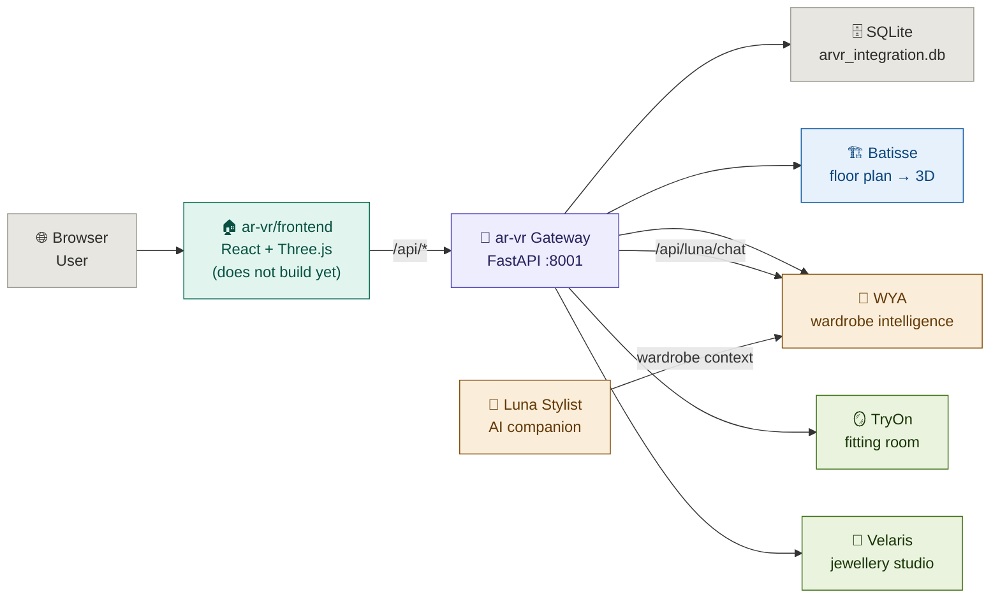

<div align="center">

# ORVYNE — Your Personal Virtual World

**Upload your floor plan. Walk through your home. Open your wardrobe. Try it on. Design the jewellery.**

[](https://github.com/ria0304/ORVYNE)


</div>

ORVYNE is a personalised virtual-world platform: a digital version of your own home that holds your wardrobe, a fitting room, a jewellery studio and an AI stylist. Five independent projects do the work; the `ar-vr/` gateway is the hub that is meant to connect them.

> **Read this first — what is real today**
>
> | Works today (as standalone projects) | Not working / not built yet |
> |---|---|
> | Floor plan → 3D dollhouse (Batisse) | The integrated experience: `ar-vr/frontend` does not build |
> | Wardrobe AI and outfit scoring (WYA) | Room navigation and Luna state in the gateway (routes return `500`) |
> | Garment cutouts, mannequin, outfit builder (TryOn) | Gateway 3D jewellery mesh (`/api/velaris/mesh` always errors) |
> | Jewellery design, CAD, PDF, DXF (Velaris) | Saving a complete look, room assignments (stubs, nothing persisted) |
> | Chat styling over WYA (Luna) | One sign-in across projects, AR / VR |
>
> The `ar-vr` gateway is a Phase 1 foundation: it starts and proxies several calls to the project backends, but its health check always reports `unreachable`, about a third of its routes return `500`, and its frontend fails to compile. Details in [Status](#status) and [Known Limitations](#known-limitations). Everything in this README was checked against the code and by running the gateway with no downstream services started.

---

## Contents

- [The Problem](#the-problem)
- [The Solution](#the-solution)
- [Core User Flow](#core-user-flow)
- [The Five Technologies](#the-five-technologies)
- [The Integration Layer](#the-integration-layer-ar-vr)
- [Architecture](#architecture)
- [Tech Stack](#tech-stack)
- [Project Structure](#project-structure)
- [Quick Start](#quick-start)
- [Verify the Gateway](#verify-the-gateway)
- [Common Issues](#common-issues)
- [Environment Variables](#environment-variables-ar-vr)
- [Status](#status)
- [Known Limitations](#known-limitations)
- [Roadmap](#roadmap)
- [License](#license)

---

## The Problem

Online fashion and jewellery shopping happens in disconnected tools, inside generic virtual malls that know nothing about the person using them.

- **Customers** keep their wardrobe in one app, outfit inspiration in another, try-on in a third and custom jewellery in a fourth. None share context, and none feel like *their* space.
- **Builders** of those tools have the opposite problem: each product is useful alone, but nothing ties them into one journey a user can walk through.

## The Solution

Instead of a generic virtual mall, every ORVYNE user gets a personal virtual space.

1. **Create your virtual home.** Upload your real floor plan. Batisse generates a 3D version.
2. **Enter your home.** Walk through your rooms with keyboard and mouse.
3. **Explore your wardrobe.** WYA brings your real wardrobe in and helps you discover outfits.
4. **Try on clothes.** TryOn generates virtual clothing previews.
5. **Design jewellery.** Visit your own jewellery boutique, powered by Velaris.
6. **Get styling help.** Luna Stylist suggests outfit combinations using your wardrobe.

The `ar-vr` backend is designed to coordinate all of it through each project's REST API. No code is duplicated and no databases are merged. Steps 2–6 inside one unified 3D home are the target, not the current state; today each step works only in its own project.

## Core User Flow

```
Sign up
   ↓
Upload floor plan (JPG / PNG / PDF)
   ↓
Batisse: plan → walls, rooms, openings → validated geometry → GLB
   ↓
Virtual home: rooms assigned a function (bedroom, study, storage …)
   ↓
 ┌───────────────┬────────────────┬──────────────────┬──────────────────┐
 ↓               ↓                ↓                  ↓
Wardrobe room   Fitting room     Jewellery boutique  Luna Stylist
WYA closet,     TryOn outfit     Velaris text /      Conversational
outfit scoring  previews         sketch / photo →    styling over WYA
                                 design + spec       wardrobe context
   ↓
Complete look (clothing + jewellery)
```

---

## The Five Technologies

| # | Project | Role | What it does |
|---|---|---|---|
| 1 | **Batisse** | Virtual home | Converts uploaded floor plans into 3D house geometry |
| 2 | **WYA** | Wardrobe intelligence | Clothing management, outfit recommendations, colour analysis, personal style |
| 3 | **TryOn** | Virtual fitting room | Previews of how clothing may look on a person |
| 4 | **Velaris** | Jewellery studio | Personalised jewellery designs from creative inspiration |
| 5 | **Luna Stylist** | AI fashion companion | Conversational styling using WYA wardrobe context |

<details>
<summary><b>1 — Batisse: floor plan → 3D home</b></summary>

FastAPI + SQLAlchemy backend with a classical CV pipeline: OpenCV / PyMuPDF preprocessing (resize, deskew, perspective correction), wall / room / opening detection with per-element confidence, Tesseract OCR for room labels and dimensions, and a Shapely geometry builder (shared walls, T-junctions, footprint, validation). Scale is proposed from labels but never auto-applied: the user confirms it with a two-point reference. The frontend is React 19 + `@react-three/fiber` with a dollhouse viewer, 2D plan editor (undo/redo) and 2D↔3D selection sync. Geometry exports to GLB.
</details>

<details>
<summary><b>2 — WYA: wardrobe intelligence</b></summary>

Full-stack fashion AI app: FastAPI backend, React + TypeScript frontend, FashionCLIP embeddings, colour matching, style profiling, outfit generation, gap analysis, weather-aware outfits and a sustainability score. Deployed on AWS (CloudFront + S3 + EC2). Screenshots live in `WYA-Whats-Your-Aesthetic-main/screenshots/`.
</details>

<details>
<summary><b>3 — TryOn: virtual fitting room</b></summary>

Turns any clothing screenshot into a transparent garment cutout, fits it to a 3D mannequin (React Three Fiber), and lets users build, save and compare outfits. An optional local CatVTON pipeline produces photorealistic renders. **The pipeline is image-based: no 3D cloth simulation, no avatar rigging.**
</details>

<details>
<summary><b>4 — Velaris: jewellery studio</b></summary>

Turns text, sketches or inspiration photos into a jeweller-ready spec sheet, parametric CAD views (7 jewellery types), realistic previews, a cost breakdown, a PDF and a 2D DXF. A multi-model OpenRouter fallback chain drives generation; four optional deep learning modules (type, style, gemstone, similarity) fail soft. **Velaris output is 2D: it produces no 3D jewellery meshes.** The gateway has its own experimental mesh route; see [Known Limitations](#known-limitations).
</details>

<details>
<summary><b>5 — Luna Stylist: AI fashion companion</b></summary>

Chat interface over WYA's API. Intent classification plus smart replies, with outfit cards and a wardrobe panel synced from the user's WYA account. The server runs on its own port (8001 in its own docs and Docker setup).
</details>

---

## The Integration Layer (`ar-vr/`)

`ar-vr/` is the main code of ORVYNE: a FastAPI gateway plus a React / Three.js frontend. The gateway

- **Proxies** requests to Batisse, WYA, TryOn, Velaris and (for Luna chat) WYA through one API
- **Adapts** each project through a dedicated `httpx` async service class that reads its base URL from `config.py`
- **Shares schemas**: `UserReference`, `RoomMetadata`, `ScaleInfo`, `AssetReference`, `RoomAssignment`
- **Defines a coordination DB** (`arvr_integration.db`, SQLite) with six tables: `integration_metadata`, `users`, `room_saves`, `outfit_saves`, `design_saves`, `luna_state`. Created on startup. No working route writes to them yet
- **Leaves the originals alone**: each project keeps its own code, API and database

### Integration endpoints

Results below come from calling every route with **no downstream project running**, plus reading the code for what would happen with them running.

Legend: ✅ delegates to the downstream project, returns a mapped error if it is down · 🟡 stub (returns `success: true`, stores nothing) · 🔴 broken (`500`, or wrong behaviour even with downstream up)

| | Method | Endpoint | Behaviour |
|---|---|---|---|
| 🔴 | `GET` | `/api/health` | Always reports every service `unreachable` (adapter helpers are never imported in `main.py`; see below) |
| ✅ | `POST` | `/api/batisse/upload` | Batisse `POST /api/projects` (JSON body only, no file upload) |
| ✅ | `GET` | `/api/batisse/projects/{id}/geometry` | Batisse validated geometry |
| ✅ | `POST` | `/api/batisse/projects/{id}/geometry/export-glb` | Batisse GLB export |
| 🟡 | `POST` | `/api/batisse/projects/{id}/geometry/scale-reference` | Placeholder, does not call Batisse |
| 🔴 | `POST` | `/api/batisse/rooms` | `500`: invalid relative import |
| 🟡 | `DELETE` | `/api/batisse/rooms/{room_id}` | Returns success, deletes nothing |
| 🔴 | `PUT` | `/api/batisse/rooms/{room_id}/dimensions` | Always returns `success: false` (bad import, and it posts to Batisse's project-create route) |
| 🔴 | `POST` | `/api/batisse/rooms/connect` | Always returns `success: false` (bad import), would persist nothing anyway |
| 🔴 | `POST` | `/api/navigation/set-position/{user_id}` | `500`: `get_db_session`, `Users`, `RoomSaves` not imported |
| 🔴 | `POST` | `/api/navigation/set-room/{user_id}/{room_id}` | `500`: same missing imports |
| 🔴 | `GET` | `/api/navigation/get-position/{user_id}` | `500`: same missing imports |
| 🟡 | `POST` | `/api/room/interact/{user_id}/{room_id}/{action}` | Echoes the action |
| 🟡 | `POST` | `/api/room/door/open/{user_id}/{from_room}/{to_room}` | Echoes the request |
| 🟡 | `POST` | `/api/room/window/toggle/{user_id}/{room_id}` | Echoes the request |
| 🔴 | `POST` | `/api/wardrobe/browse?user_id=` | WYA `GET /api/user/wardrobe`. `500` when WYA is down; `user_id` is a **query** parameter |
| 🔴 | `POST` | `/api/wardrobe/outfit-recommendations?user_id=` | WYA `GET /api/ai/outfit-score`. `500` when WYA is down; query parameters only |
| 🔴 | `POST` | `/api/tryon/generate` | TryOn `POST /api/tryon`. Takes **query** parameters (`garment_image_url`, `avatar_params`, `user_id`), so a JSON body returns `422` |
| 🔴 | `GET` | `/api/tryon/status` | Always returns `unhealthy / initializing`: the adapter method references an undefined `user_id`, and the route swallows the error |
| ✅ | `POST` | `/api/jewellery/generate-design` | Velaris `POST /api/generate-design` |
| 🟡 | `GET` | `/api/jewellery/designs` | Velaris `GET /api/trends` (trend data, not saved designs) |
| 🔴 | `POST` | `/api/velaris/mesh` | Experimental 3D mesh, fails on every input (see [Known Limitations](#known-limitations)) |
| ✅ | `POST` | `/api/luna/chat?message=&token=` | WYA `POST /api/luna/chat` (path now correct). Query parameters for `message` and `token` |
| 🔴 | `GET` | `/api/luna/state/get_state` | `500`: `get_db_session`, `LunaState`, `USER_ID` undefined |
| 🔴 | `POST` | `/api/luna/state/toggle_following` | `500`: same |
| 🔴 | `POST` | `/api/luna/state/set_expression` | `500`: same (form field `expression`) |
| 🟡 | `POST` | `/api/integrate/assign-room-function` | Echoes the assignment, no persistence |
| 🟡 | `POST` | `/api/integrate/save-look` | Echoes a look id, no persistence |

Tally: 28 routes · 5 ✅ · 8 🟡 · 15 🔴. Nine of those return an HTTP `500` with no downstream service running.

Room functions: `bedroom`, `living_room`, `kitchen`, `bathroom`, `dining_room`, `storage`, `spare_bedroom`, `study`, `balcony`, `hallway`, `other`.

---

## Architecture



Solid arrows exist in code, though many of those routes are stubs or broken (see the endpoint table). The gateway's `/api/luna/chat` talks to WYA's Luna router; the standalone Luna server is not called by the gateway.

---

## Tech Stack

| Layer | Technologies |
|---|---|
| **Gateway (`ar-vr/backend`)** | FastAPI, Uvicorn, Pydantic, `httpx`, SQLAlchemy + SQLite (PostgreSQL via `DATABASE_URL`), `python-dotenv`, `trimesh` + `numpy` (3D mesh route), `python-multipart` (form route). `slowapi` is listed but not wired |
| **Gateway frontend (`ar-vr/frontend`)** | React 19, `react-router-dom` 7, Three.js (`OrbitControls`, `GLTFLoader`), Vite. A single 1,383-line `App.tsx` with five pages (Batisse, Wardrobe, TryOn, Jewellery, Luna) |
| **Project frontends** | React + TypeScript + Vite, Tailwind CSS, Three.js / `@react-three/fiber` / `@react-three/drei` (Batisse, TryOn), Zustand (Batisse) |
| **Project backends** | FastAPI across all five. OpenCV, Shapely, PyMuPDF, Tesseract (Batisse) · FashionCLIP, AWS SageMaker (WYA) · rembg, MediaPipe, CatVTON (TryOn) · OpenRouter fallback chain, PyTorch, ultralytics, CLIP, ReportLab, `ezdxf` (Velaris) |

---

## Project Structure

```
ORVYNE/
├── ar-vr/                  # ★ Integration layer (gateway + frontend)
│   ├── backend/app/        #   main.py, config.py, database.py, schemas.py, services/
│   ├── frontend/           #   Vite + React + Three.js app (fails to compile, see below)
│   └── tests/              #   test_integration.py (23 tests, weak assertions)
├── batisse/                # Floor plan → 3D dollhouse
├── WYA-Whats-Your-Aesthetic-main/   # Wardrobe intelligence
├── TryOn-main/             # Virtual fitting room
├── Velaris-From-Inspiration-to-Jewellery-Design-main/   # Jewellery studio
└── luna-stylist-main/      # AI fashion companion
```

Each folder has its own README with project-level detail. `ar-vr/README.md` covers the gateway in depth.

---

## Quick Start

Each project is its own service. Start only what you need, then the gateway.

**Prerequisites:** Python 3.10+ (3.12 used for the checks in this README), Node.js 18+, and the Tesseract OCR binary (Batisse only).

### 1. Pick a port map

All project backends default to port `8000`, so they collide. Use this map throughout:

| Service | Backend port | Frontend port |
|---|---|---|
| `ar-vr` gateway | 8001 | 2000 |
| Batisse | 8010 | 5173 |
| WYA | 8020 | 3000 |
| TryOn | 8030 | 3002 |
| Velaris | 3000 (see note) | 5173 |
| Luna (optional) | 8002 | Vite default |

> **Port notes.**
> - The gateway is on `8001` because `ar-vr/frontend` defaults to `http://127.0.0.1:8001` and its CORS list is built around that. Luna's own docs also use `8001`, so run Luna on `8002` locally and set `VITE_LUNA_API_URL` accordingly.
> - Batisse and Velaris frontends both default to `5173`, and WYA and Velaris's backend both want `3000`. Run only one of each pair at a time, or pass `--port` to Vite / Uvicorn. Velaris's Vite dev server proxies `/api` to `http://localhost:3000`, so if you move the Velaris backend, edit that proxy.
> - **Batisse proxy.** `batisse/frontend/vite.config.ts` proxies `/api` to `127.0.0.1:8000`. If you run the Batisse backend on `8010`, edit that proxy target.

### 2. Clone

```bash
git clone https://github.com/ria0304/ORVYNE.git
cd ORVYNE
```

### 3. Start the project backends (one terminal each)

```bash
# Batisse
cd batisse/backend && pip install -r requirements.txt
uvicorn app.main:app --reload --port 8010

# WYA
cd WYA-Whats-Your-Aesthetic-main && pip install -r requirements.txt
uvicorn main:app --reload --port 8020

# TryOn
cd TryOn-main/backend && pip install -r requirements.txt
uvicorn main:app --reload --port 8030

# Velaris
cd Velaris-From-Inspiration-to-Jewellery-Design-main && pip install -r requirements.txt
cp .env.example .env     # add OPENROUTER_API_KEY
uvicorn main:app --reload --port 3000

# Luna (optional)
cd luna-stylist-main/server && pip install -r requirements.txt
uvicorn main:app --reload --port 8002
```

### 4. Configure and start the gateway

```bash
cd ar-vr/backend
pip install -r requirements.txt
pip install trimesh numpy python-multipart   # missing from requirements.txt; the app will not import without them
cp env.example .env
```

Edit `ar-vr/backend/.env` so the service URLs match the port map. `env.example` ships with all four URLs set to `:8000`, which collides:

```env
BATISSE_BASE_URL=http://127.0.0.1:8010
WYA_BASE_URL=http://127.0.0.1:8020
TRYON_BASE_URL=http://127.0.0.1:8030
VELARIS_BASE_URL=http://127.0.0.1:3000
INTEGRATION_JWT_SECRET=change-me
CORS_ORIGINS=http://localhost:2000,http://127.0.0.1:2000
```

```bash
uvicorn app.main:app --reload --port 8001
```

Open the API docs at <http://localhost:8001/docs>. The adapters read the `*_BASE_URL` values from `config.py`, so the `.env` above takes effect.

### 5. Run a project frontend

```bash
cd batisse/frontend && npm install && npm run dev                                   # floor plan → 3D
cd WYA-Whats-Your-Aesthetic-main && npm install && npm run dev                      # wardrobe
cd TryOn-main && npm install && npm run dev                                         # fitting room
cd Velaris-From-Inspiration-to-Jewellery-Design-main && npm install && npm run dev  # jewellery
cd luna-stylist-main && npm install && npm run dev                                  # Luna chat
```

The `ar-vr/frontend` is deliberately left out of this list: `npm run dev` starts, but the file fails to compile (see [Known Limitations](#known-limitations)) so you get an error overlay, not an app.

---

## Verify the Gateway

```bash
curl http://localhost:8001/api/health
```

Expect every service to read `unreachable`, even with all four projects running. That is a known bug, not a sign your setup is wrong.

A call that does reach a downstream project:

```bash
curl -X POST http://localhost:8001/api/jewellery/generate-design \
  -H "Content-Type: application/json" \
  -d '{
    "prompt": "A simple emerald ring with gold band",
    "inputType": "text",
    "style": "Contemporary Minimalist",
    "budget": "Balanced"
  }'
```

With Velaris down this returns `{"error": "VELARIS backend unavailable in test environment"}` with HTTP `200`.

**Run the tests**

```bash
pip install pytest
cd ar-vr/backend && PYTHONPATH=. python -m pytest ../tests/
```

Result with `trimesh`, `numpy` and `python-multipart` installed and no downstream services started: **23 passed, 0 failed.** Without those three packages, collection fails with `ModuleNotFoundError: No module named 'trimesh'`.

Do not read "23 passed" as "the gateway works". Most assertions accept `200` or `422`, and the routes that swallow downstream errors return `200` on failure. The tests never touch the navigation, Luna-state or room routes, which are the ones that return `500`.

---

## Common Issues

| Problem | Fix |
|---|---|
| `ModuleNotFoundError: trimesh` (or `numpy`, `python-multipart`) when starting the gateway | `pip install trimesh numpy python-multipart`. They are missing from `ar-vr/backend/requirements.txt` |
| Services all fail to respond | Batisse, WYA and TryOn default to `:8000`. Give each its own port and set the matching `*_BASE_URL` in `ar-vr/backend/.env` |
| Batisse frontend cannot reach its backend | Its Vite proxy targets `127.0.0.1:8000`. Change it if the backend runs elsewhere |
| `/api/health` shows `unreachable` for every service | Known bug. `main.py` never imports `get_*_service` at module level, so the route raises `NameError` and the `except` marks everything unreachable. Even once imported, adapter `ping()` methods return `False` instead of raising and the route ignores the return value |
| `500 Internal Server Error` on `/api/navigation/*` or `/api/luna/state/*` | Known bug: missing imports in `main.py` (see the endpoint table) |
| `422` on `/api/tryon/generate` or `/api/wardrobe/*` | These routes read **query** parameters, not a JSON body |
| `ar-vr/frontend` shows a compile error | Known: a corrupted block in `App.tsx` (see Known Limitations) |
| Batisse OCR does nothing | Install the Tesseract binary (`pytesseract` is only a wrapper) |
| Velaris says `OPENROUTER_API_KEY` not set | Add it to that project's `.env` and restart |
| WYA / Luna features offline on hosted demos | The EC2 backends are paused to save AWS cost. Run them locally |
| Frontend blank or API errors | Start the backend first |

---

## Environment Variables (`ar-vr`)

| Variable | Required | Description |
|---|---|---|
| `BATISSE_BASE_URL` | Yes (in practice) | Batisse backend URL (default `http://127.0.0.1:8000`) |
| `WYA_BASE_URL` | Yes (in practice) | WYA backend URL, also used by `/api/luna/chat` (default `http://127.0.0.1:8000`) |
| `TRYON_BASE_URL` | Yes (in practice) | TryOn backend URL (default `http://127.0.0.1:8000`) |
| `VELARIS_BASE_URL` | Yes (in practice) | Velaris backend URL (default `http://127.0.0.1:8000`) |
| `INTEGRATION_JWT_SECRET` | Reserved | Read from config but not used by any route yet. Change the dev default anyway |
| `DATABASE_URL` | No | Coordination DB (default `sqlite:///./arvr_integration.db`, relative to the working directory) |
| `CORS_ORIGINS` | No | Comma-separated frontend origins (default: localhost `2000`, `3000`, `5173`) |
| `ASSETS_DIR` / `MODELS_DIR` / `TEXTURES_DIR` | No | Asset folders, created on startup |
| `APP_NAME` / `APP_VERSION` / `DEBUG` | No | Service identity and SQL echo |
| `VITE_API_URL` (frontend) | No | Gateway URL used by `ar-vr/frontend` (default `http://127.0.0.1:8001`) |

The four `*_BASE_URL` defaults are identical, so they are "required" in practice whenever more than one project runs on one machine. `env.example` also lists `WYA_APP_BASE_URL`, `ALLOWED_ORIGINS` and `DEFAULT_MODEL_CHAIN`; no code reads them.

---

## Status

| Component | Status |
|---|---|
| Batisse: floor plan → validated geometry → GLB | ✅ Standalone project |
| WYA: wardrobe, outfits, style profile | ✅ Standalone project |
| TryOn: cutouts, mannequin, outfit builder, optional CatVTON | ✅ Standalone project |
| Velaris: jewellery design, CAD, PDF, DXF | ✅ Standalone project |
| Luna: conversational styling over WYA | ✅ Standalone project |
| `ar-vr` gateway: starts, config-driven adapters, shared schemas | 🟡 Runs once `trimesh`, `numpy`, `python-multipart` are installed |
| `ar-vr` proxy routes (Batisse upload / geometry / GLB, Velaris design, Luna chat) | 🟡 Delegate to the downstream project; untested against live downstream services |
| `ar-vr` health check | 🔴 Always `unreachable` |
| `ar-vr` navigation, room-create / connect / dimensions, Luna state routes | 🔴 `500` or always-failure (missing imports) |
| `ar-vr` wardrobe / try-on routes | 🔴 `500` when downstream is down, query-parameter signatures |
| `ar-vr` door / window / interact / room-function / save-look routes | 🟡 Stubs: return success, store nothing |
| `ar-vr` 3D jewellery mesh (`/api/velaris/mesh`) | 🔴 Fails on every input |
| `ar-vr/frontend` | 🔴 Does not compile |
| Coordination DB writes (room assignments, saved looks, Luna state) | 🔲 Tables exist, no working route writes to them |
| Cross-project identity / auth coordination | 🔲 Planned |
| Wardrobe / fitting room / boutique inside the 3D home | 🔲 Planned |
| AR / VR (OpenXR) | 🔲 Future |

---

## Known Limitations

**The headline experience is not usable yet.**
`ar-vr/frontend` is a real application in code (Three.js scene, `OrbitControls`, `GLTFLoader`, five routed pages, a keyboard-controlled first-person mode), but it does not compile:
- `src/App.tsx` has a corrupted block around lines 160–170, inside the keyboard-handler `useEffect`: a duplicated `toast('Interact with object')` fragment leaves unbalanced braces. `vite build` fails with `Expected ',' or ')' but found '}'`.
- The file uses `React.useRef` / `React.useEffect` 49 times but only imports named hooks from `'react'`, so it would still fail at runtime with `React is not defined` after the syntax fix.
- The `switch` over `KeyW` / `KeyS` and the other movement keys has no `break` statements, so one key press sets several movement flags.
- `src/App.final` is an older 1,326-line copy that is not imported anywhere.
- The only working 3D dollhouse viewer today is in Batisse's own frontend.

**The gateway needs fixes before it works end to end.**
- `requirements.txt` omits `trimesh`, `numpy` and `python-multipart`. The app imports `trimesh` at module level, so it does not start from a clean install.
- `/api/health` and the startup log are unreliable: `main.py` imports the `get_*_service` helpers only inside `lifespan`, so `health()` raises `NameError` and reports `unreachable`. Separately, every adapter `ping()` returns `False` instead of raising, and both the lifespan code and `health()` ignore the return value. TryOn is logged as "reachable" with no check at all. WYA's ping targets `/api/health/ready`, but WYA serves `/health/ready`.
- The navigation routes (`/api/navigation/*`) and Luna state routes (`/api/luna/state/*`) use `get_db_session`, `Users`, `RoomSaves`, `LunaState`, `USER_ID` and `func`, none of which `main.py` imports, so they return `500`. Even with imports added, they filter `Users` and `RoomSaves` by columns that do not match the models (`Users` has `id`, not `user_id`; `RoomSaves` has no `updated_at`), and `USER_ID` is not defined anywhere.
- `/api/batisse/rooms` and `/api/batisse/rooms/connect` use `from ..services.batisse_service import ...`, a relative import that goes past the top-level package. `/api/batisse/rooms/{id}/dimensions` does the same and also posts to Batisse's project-create endpoint.
- `main.py` defines `batisse_set_scale_reference` twice; the second copy has no route decorator.
- `/api/tryon/status` always returns the fallback `unhealthy`: `TryOnService.get_tryon_status()` references an undefined `user_id`.
- `/api/wardrobe/*` and `/api/tryon/generate` declare their inputs as query parameters while the frontend and the tests send JSON bodies. When WYA is down, the wardrobe routes raise instead of returning a mapped error.
- `VelarisService.find_similar` calls `/api/similar`, but Velaris serves `/api/find-similar`. No gateway route calls it yet.
- Several routes (`/api/jewellery/*`, `/api/batisse/upload`, geometry, GLB) return HTTP `200` with `success: false` or an `error` field when the downstream project is down, so clients cannot rely on the status code.
- Stub routes return `success: true` without storing anything, so a client cannot tell them from working endpoints.
- `slowapi` is installed but not wired. `models.py` and `api/` are not part of the gateway.

**The 3D jewellery mesh route does not work.** `POST /api/velaris/mesh` fails on every input, even with Velaris running:
- `generate_3d_mesh` reads an undefined variable `cart` (typo for `carat`), raising `NameError` once the design call succeeds.
- The `ring` branch calls `trimesh.creation.torus(R=…, r=…)`, which the current `trimesh` (5.x) rejects (`major_radius` / `minor_radius` are required).
- The `necklace` / `pendant` branch builds a face array that indexes past the vertex list (`IndexError`).
- `earrings` and `bracelet` build non-watertight meshes (the bracelet uses quad faces).
- The result is encoded with `Scene.dump_gltf()`, which does not exist in `trimesh`, so the last step errors too.
- Material parameters (metal, roughness, gemstone) are stored in `mesh.metadata`, which glTF export does not carry over.

**Auth is not coordinated.** WYA uses JWT, TryOn uses a guest `X-User-Id` header. `INTEGRATION_JWT_SECRET` is configured but unused. There is no cross-project login.

**Tests are weaker than they look.** 23 tests pass, but most accept `200` or `422`, run against a gateway with no downstream services, and skip the routes that return `500`.

**Each project has its own limits.**
- TryOn is image-based: no 3D garment simulation, rigging or cloth physics.
- Velaris is 2D: concept drawings, not manufacturing-validated CAD.
- Batisse is classical CV: quality depends on plan quality, and scale must be user-confirmed.

**Operations.** Hosted demos for WYA and Luna are paused to manage AWS cost. There is no unified Docker setup. Running six services needs six terminals and a hand-maintained port map.

---

## Roadmap

Ordered by what unblocks the most.

**Now: make the gateway trustworthy**
- [ ] Add `trimesh`, `numpy`, `python-multipart` to `ar-vr/backend/requirements.txt` (or make the mesh import lazy)
- [ ] Import the missing names in `main.py`; fix the `..services` relative imports
- [ ] Fix `/api/health`: import the helpers, make `ping()` raise or have callers check the result, correct WYA's health path
- [ ] Return real HTTP errors (`502` / `503`) when a downstream project is down, and `501` from stub routes
- [ ] Switch wardrobe and try-on routes to request bodies; fix `get_tryon_status`
- [ ] Fix or remove `/api/velaris/mesh` (typo, torus call, necklace indices, glTF export)
- [ ] Tests that assert real behaviour, including the navigation and Luna-state routes

**Next: make something walkable**
- [ ] Fix the corrupted block in `ar-vr/frontend/src/App.tsx`, import `React`, add the missing `break`s; confirm `vite build` passes
- [ ] Load a Batisse GLB in the Three.js scene with keyboard + mouse navigation, against a live gateway
- [ ] Persist room assignments in the coordination DB
- [ ] Single sign-in across projects

**Later**
- [ ] Room functions in 3D (bedroom → wardrobe, study → boutique, hallway → fitting room)
- [ ] Luna available in every room
- [ ] Save complete looks (clothing + jewellery)
- [ ] 3D garments and jewellery meshes
- [ ] Docker Compose + PostgreSQL
- [ ] AR / VR (OpenXR)

---

## License

Each component keeps its own licence. WYA is source-available under **PolyForm Strict 1.0.0** (non-commercial, no redistribution, no derivatives); see `WYA-Whats-Your-Aesthetic-main/LICENSE.md`. Check each project's folder before reusing code.
