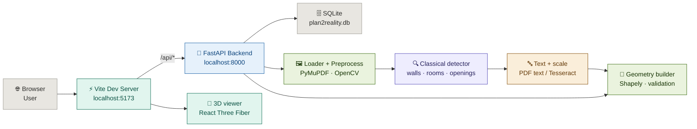

<div align="center">

[](https://github.com/ria0304/Batisse)


# Batisse — From Floor Plan to 3D Dollhouse


**Upload it. Review it. Fix it. Walk through it in 3D.**

Batisse turns a 2D floor plan (JPG, PNG or PDF) into an editable, validated room-and-wall model with a known real-world scale, ready to be extruded into a 3D dollhouse view. Every detected element is a **draft the user reviews** — nothing is silently trusted.

</div>

---

## The Problem

Floor plans are flat, and turning them into something you can actually see is slow and error-prone.

**Home buyers and renters** struggle to picture a space from a 2D drawing, and cannot easily tell whether the rooms are the size they imagine.

**Designers and developers** retrace plans by hand in CAD or 3D tools just to get a first volumetric view, and any automatic tool that guesses silently produces models nobody can trust.

---

## The Solution

Batisse bridges a flat drawing and a 3D model with a deterministic, transparent pipeline.

A user brings a plan in one of three forms:

- **Photo** — a JPG/JPEG picture of a printed plan (perspective and skew are corrected)
- **Scan / screenshot** — a PNG of a plan
- **PDF** — a multi-page PDF, one page = one floor (the text layer is read directly when present)

The system outputs:

- A **detected draft**: room polygons, wall thickness, and door/window candidates, each with a confidence value
- A **structured geometry model** (`FloorPlanGeometry`): rooms, derived walls, openings, footprint, areas, and a list of issues
- **Scale proposals** from evidence in the drawing (room dimension labels such as `12'-6" x 14'-0"` or `3.5 x 4.2 m`, or a `1:100` note on a PDF) — proposed, never auto-applied
- A **processing report** that says exactly which steps ran, what was *not* attempted, and what to double-check
- A **3D-readiness gate**: 3D generation is blocked until the geometry is metric and has no blocking errors

---

## Core User Flow

```
Upload plan (JPG / PNG / PDF)
        ↓
Validation (magic-byte sniffing, size / page / pixel limits, password-PDF rejection)
        ↓
Preprocess (resize → optional perspective correction → deskew → ink mask)
        ↓
Classical detector → walls, rooms, door/window gap candidates
        ↓
Text reading (PDF text layer, else Tesseract OCR) → room labels + dimension labels
        ↓
Scale proposals (OCR dimensions / drawing ratio) — user confirms or enters a reference length
        ↓
Deterministic geometry builder → derived walls, footprint, areas, issues
        ↓
User reviews the geometry, issues and scale in the workspace
        ↓
Ready-for-3D gate (metric units, no errors) → Three.js dollhouse view
```

> **Status note:** the interactive 2D editor (`PlanEditor.tsx`) is now mounted on the Geometry tab, but its working copy is never loaded from the processed geometry, so it currently shows "No geometry loaded". Until that is fixed, review and edits go through the stateless `/geometry/rebuild` and `PUT /geometry` endpoints. See [Known Limitations](#known-limitations).

---

## Features

| Feature | Status |
|---|---|
| JPG / PNG / PDF upload with content sniffing (extension must match real content) | ✅ |
| Multi-page PDF support (select the page to process) | ✅ |
| Image preprocessing: resize, perspective correction, deskew, ink mask | ✅ |
| Classical (non-ML) wall / room / opening detector | ✅ |
| Per-element provenance (`manual` / `detected` / `derived`) and confidence | ✅ |
| Room label + dimension reading (PDF text layer or Tesseract OCR) | ✅ |
| Scale proposals from labels and drawing ratio, never auto-applied | ✅ |
| User scale reference (two points + a real length) | ✅ |
| Deterministic geometry rebuild (shared walls, T-junctions, L-shapes, opening snapping) | ✅ |
| Geometry validation with errors / warnings / info issues | ✅ |
| Stateless `/geometry/rebuild` for live editing | ✅ |
| Persistent projects, uploads and processing runs (SQLite) | ✅ |
| Uniform, human-readable error format | ✅ |
| Processing report incl. an explicit "not attempted" list | ✅ |
| Typed frontend API client mirroring the backend schema | ✅ |
| Dashboard (create / list / delete projects) and a project workspace with Plan, Processing, Scale, Geometry and 3D tabs | ✅ |
| Scale UI: apply a two-point reference, or accept a proposed / typed metres-per-pixel value | ✅ |
| 3D dollhouse viewer (extruded walls split around openings, floor slabs, opening panels, orbit camera) — shown only once geometry is in metres | ⚠️ implemented, but the new selection code likely crashes it (see Known Limitations) |
| 2D plan editor (SVG, zoom / pan, wall + opening tools, grid snap, undo / redo store) | ⚠️ mounted on the Geometry tab, but never loads geometry |
| 2D ↔ 3D element selection through the shared editor store, with highlight in the 3D view | ⚠️ written, not working |
| Dollhouse view presets and Walls / Floors / Roof toggles | ❌ controls render but do nothing, and the panel is now unclickable |
| Brand gradient (logo, dashboard heading, create button, active workspace tab) | ✅ |
| Learned (ML) wall segmentation | ❌ optional future phase (`requirements-ai.txt`) |
| Stairs, furniture, curved / diagonal walls, multi-storey in one image | ❌ not supported |

---

## Detection Pipeline

The detector is a **classical computer-vision pipeline, not a neural network** (`is_ml_model: false` in every report). It is deliberately conservative: it would rather return nothing than invent rooms.

| Stage | What it does |
|---|---|
| **Loader** (`processing/loader.py`) | Identifies the file from its magic bytes, renders PDF pages with PyMuPDF (200 DPI, capped at 4000 px), counts vector paths, extracts the PDF text layer, and rejects empty, corrupt, oversized or password-protected files |
| **Preprocess** (`processing/preprocess.py`) | Resizes to at most 2400 px, applies optional perspective correction and deskew, and produces an ink mask. Every step reports *applied / skipped and why*, and all geometric steps compose into one homography so PDF text boxes can be carried along |
| **Detect** (`processing/detect.py`) | Finds solid wall strokes, estimates wall thickness, extracts closed rooms as centerline polygons, and flags gaps between collinear wall runs as door/window candidates (`needs_review`) |
| **Text** (`processing/ocr.py`) | Reads room labels (living, bedroom, kitchen, bathroom, …) and parses dimensions — feet-inches pairs, metric pairs, mm, comma decimals. Bare numbers are never guessed |
| **Scale** (`processing/scale.py`) | Compares label dimensions with each room's measured pixel size and proposes a metres-per-pixel value only when the evidence is self-consistent; conflicting labels or non-rectangular rooms produce a note instead of a proposal |
| **Geometry** (`geometry/builder.py`) | Pure, deterministic reconstruction of rooms and openings into validated walls, footprint, areas and issues |

**Confidence values are transparent heuristics, not calibrated accuracy.** Door/window detections are unverified candidates and are flagged for review.

---

## Geometry Model

One structured format (`backend/app/geometry/schema.py`, version 1) drives the editor, the API and the 3D view.

- **Units** are either `px` (scale unknown — 3D blocked) or `m` (scale known). Geometry in metres must carry a known scale source; geometry in pixels must not.
- **Scale source** is one of `unknown`, `user_reference`, `ocr_dimension`, `vector`, `manual`, with a confidence and note.
- **Vertical quantities** (wall height, door height, sill height, slab thickness, elevation) are always metres. They are adjustable defaults (e.g. 2.7 m walls, 2.1 m doors) and are **never claimed to be extracted from the plan**.
- **Walls** are derived from room polygons and centred on their plan line. Shared edges become a single interior wall; slightly misaligned edges are merged; partial overlaps split into T-junctions.
- **Openings** snap to the nearest wall and get a `wall_id` and `offset`. An opening away from any wall is flagged, not cut.
- **Issues** (`error` / `warning` / `info`) cover overlapping rooms, self-intersections, openings wider than their wall, unknown scale, and more. Errors block saving and 3D.
- **Axes:** plan +x → 3D +x, plan +y → 3D +z, up is +y.
- **Room types:** living, bedroom, kitchen, bathroom, dining, hallway, balcony, utility, storage, other.

---

## Architecture



---

## Tech Stack

**Frontend**
- React 19 + TypeScript + Vite
- Tailwind CSS 4 (`@tailwindcss/vite`)
- Three.js with `@react-three/fiber` and `@react-three/drei` (3D view)
- `react-router-dom` (routing) and `zustand` (app store + geometry editor store with 50-step undo / redo)
- Vitest for tests

**Backend**
- FastAPI (Python) with Pydantic v2 schemas
- SQLAlchemy 2 over SQLite (projects, uploads, processing runs; geometry stored as versioned JSON)
- OpenCV (headless) + NumPy for preprocessing and detection
- PyMuPDF for PDF rendering and text-layer extraction
- Shapely for polygon and wall geometry
- `pytesseract` + Pillow for OCR (optional at runtime — needs the Tesseract binary)
- pytest + httpx for tests

**Optional (not needed for the deterministic pipeline)**
- PyTorch / torchvision (`requirements-ai.txt`) — reserved for a future CubiCasa5K-style segmentation phase

---

## Project Structure

```
Batisse/
│
├── backend/                          # All Python server-side logic
│   ├── app/
│   │   ├── main.py                   # FastAPI app factory, CORS, /api/health, router mounting
│   │   ├── config.py                 # Env-driven settings (data dir, DB URL, upload limit, CORS)
│   │   ├── database.py               # SQLAlchemy engine + session
│   │   ├── models.py                 # Project, Upload, ProcessingRun tables
│   │   ├── schemas.py                # API request/response models, unit conversion
│   │   ├── errors.py                 # Uniform {"error": {code, message, details}} handlers
│   │   ├── routers/
│   │   │   ├── projects.py           # Project CRUD
│   │   │   ├── uploads.py            # Upload, list, preview page, delete
│   │   │   ├── processing.py         # Run detection, latest report, processed plan image
│   │   │   └── geometry.py           # Get / put / rebuild geometry, scale reference + accept
│   │   ├── services/
│   │   │   └── projects.py           # Geometry load/save, 3D-readiness, file cleanup
│   │   ├── processing/
│   │   │   ├── loader.py             # Safe JPG/PNG/PDF loading, magic-byte sniffing, PDF render
│   │   │   ├── preprocess.py         # Resize, perspective, deskew, ink mask
│   │   │   ├── detect.py             # Classical wall / room / opening detector
│   │   │   ├── ocr.py                # Label classification + dimension parsing
│   │   │   ├── scale.py              # Scale proposals from labels and drawing ratio
│   │   │   └── pipeline.py           # End-to-end orchestration + processing report
│   │   └── geometry/
│   │       ├── schema.py             # FloorPlanGeometry format (v1) and validators
│   │       └── builder.py            # Deterministic walls / footprint / issues / apply_scale
│   ├── tests/
│   │   ├── conftest.py               # Test client + isolated temp data dir
│   │   ├── synth.py                  # Synthetic floor-plan generator
│   │   ├── test_api.py               # Upload rejections, full flow, scale + geometry endpoints
│   │   ├── test_geometry.py          # Walls, T-junctions, L-shapes, openings, scaling
│   │   ├── test_ocr_parsing.py       # Dimension / label / drawing-ratio parsing, scale proposals
│   │   └── test_pipeline.py          # Detection, deskew, blank pages, real-pixel OCR
│   ├── pytest.ini
│   ├── requirements.txt              # Runtime dependencies
│   ├── requirements-dev.txt          # + pytest, httpx
│   └── requirements-ai.txt           # Optional: torch / torchvision (future phase)
│
├── frontend/                         # React + TypeScript frontend
│   ├── src/
│   │   ├── api/
│   │   │   ├── client.ts             # Typed fetch client for every backend endpoint
│   │   │   └── types.ts              # Types mirroring the backend geometry schema
│   │   ├── pages/
│   │   │   ├── DashboardPage.tsx     # Project list + create form
│   │   │   ├── ProjectWorkspacePage.tsx  # Plan / Processing / Scale / Geometry / 3D tabs
│   │   │   └── NotFoundPage.tsx
│   │   ├── components/
│   │   │   ├── common/               # Button, Card, Badge, Input, ErrorBanner, EmptyState, LoadingSpinner
│   │   │   ├── geometry/PlanEditor.tsx   # 2D SVG editor (mounted on the Geometry tab; see limitations)
│   │   │   └── layout/Layout.tsx     # Sidebar shell (not used by the current router)
│   │   ├── three/
│   │   │   ├── DollhouseViewer.tsx   # Canvas, lighting, orbit controls, click-to-select, view / layer panel
│   │   │   ├── BuildingModel.tsx     # Geometry → walls, slabs, floors, opening meshes, selection highlight
│   │   │   ├── CameraControls.tsx    # Standalone OrbitControls wrapper
│   │   │   └── materials.ts          # Shared Three.js materials
│   │   ├── store/
│   │   │   ├── useAppStore.ts        # Projects, uploads, current geometry
│   │   │   └── useGeometryEditor.ts  # Editable working copy, selection, undo / redo
│   │   ├── hooks/                    # useProjects, useUploads, useProcessing, useGeometry
│   │   ├── utils/
│   │   │   ├── geometry.ts           # Polygon math, unit and axis conversion
│   │   │   └── validation.ts         # Client-side geometry validation
│   │   ├── __tests__/                # Vitest: API client + type constants (7 tests)
│   │   ├── App.tsx                   # Routes: /, /projects/:projectId, 404
│   │   ├── main.tsx
│   │   └── index.css                 # Global styles + brand gradient utilities
│   ├── index.html                    # Vite HTML entry point
│   ├── package.json                  # Node dependencies + scripts
│   ├── tsconfig.json                 # TypeScript compiler config
│   └── vite.config.ts                # Vite config — proxies /api/* to http://127.0.0.1:8000
│
├── DEVLOG.md                         # Working log of what each session changed (some claims there are ahead of the code)
├── package-lock.json                 # Empty stub at the repo root; the real lockfile is in frontend/
└── .gitignore
```

---

## Run Locally

Both the frontend and backend must run simultaneously. The Vite dev server proxies all `/api/*` requests to the backend at `http://127.0.0.1:8000` — no CORS config needed for local development.

**Step 1 — Clone**

```bash
git clone https://github.com/ria0304/Batisse.git
cd Batisse
```

**Step 2 — Install Tesseract (optional, recommended)**

Tesseract is only needed to read room labels and dimensions from **image** plans. PDFs with a text layer are read directly without it, and everything else works without it.

```bash
# macOS
brew install tesseract
# Ubuntu / Debian
sudo apt install tesseract-ocr
```

**Step 3 — Start the backend** (Terminal 1)

```bash
cd backend
python -m venv .venv && source .venv/bin/activate   # Windows: .venv\Scripts\activate
pip install -r requirements.txt

# Start FastAPI on port 8000
uvicorn app.main:app --reload --port 8000
```

The SQLite database and the `data/` folders (uploads, processed plan images) are created automatically on first run.

**Step 4 — Start the frontend** (Terminal 2)

```bash
cd frontend
npm install
npm run dev
```

**Step 5 — Open the app**

```
http://localhost:5173
```

If your backend runs on a different port, change the proxy `target` in `frontend/vite.config.ts` (it is currently hard-coded to `http://127.0.0.1:8000`; there is no environment-variable override).

---

## Verify the backend is working

```bash
# open in your browser:
http://localhost:8000/docs
```

```bash
curl http://localhost:8000/api/health
# {"status":"ok","version":"0.1.0","tesseract_available":true}
```

```bash
# Create a project, upload a plan, and run detection
curl -X POST http://localhost:8000/api/projects \
  -H "Content-Type: application/json" \
  -d '{"name": "Flat 4B"}'

curl -X POST http://localhost:8000/api/projects/1/uploads -F "file=@plan.pdf"

curl -X POST http://localhost:8000/api/projects/1/process \
  -H "Content-Type: application/json" \
  -d '{"upload_id": 1, "page_index": 0, "replace_existing": false}'
```

**Run the tests**

```bash
cd backend
pip install -r requirements-dev.txt

# Backend (45 tests, no API keys or models needed)
pytest

# Frontend type-check, tests and production build
cd ../frontend
npm run typecheck
npm test        # 7 tests (API client + type constants)
npm run build   # tsc --noEmit && vite build
```

The one test that reads labels from real rendered pixels is skipped automatically when the Tesseract binary is not installed.

---

## Common Issues

| Problem | Fix |
|---|---|
| Frontend shows "Cannot reach the Plan2Reality backend" | Start the backend first, and check it is on port 8000 (or change the proxy target in `frontend/vite.config.ts`) |
| `tesseract_available` is `false` in `/api/health` | Install the Tesseract binary. Image plans then get no OCR labels or scale proposals; PDFs with a text layer still work |
| Upload rejected with `extension_mismatch` | The file's real content (JPG/PNG/PDF) differs from its extension — re-export it |
| Upload rejected with `file_too_large` | Raise `PLAN2REALITY_MAX_UPLOAD_MB` (default 25) |
| Password-protected PDF rejected | Remove the password and upload again |
| `geometry_exists` (409) when processing | The project already has geometry — send `replace_existing: true` to run detection again. The workspace UI always sends `false`, so re-running detection currently needs the API (or a new project) |
| "No reliable scale evidence was found" | Provide a scale reference: two points on the plan and the real length between them |
| 3D is blocked (`ready_for_3d: false`) | Geometry is still in pixels (set a scale) or has `error` issues (fix overlaps / self-intersections). The 3D tab itself only checks for metric units; the header badge reflects the full backend check |
| No rooms detected on a thin-outline plan | The classical detector needs solid / thick wall strokes. The report flags thin-outline plans as unreliable rather than guessing |
| 3D tab crashes or shows a blank error screen | `DollhouseViewer` calls `useThree()` outside `<Canvas>`, which React Three Fiber rejects. The hook must move into a component rendered inside the canvas |
| Geometry tab says "No geometry loaded" after processing | The editor store is never filled from the processed geometry. Use the API endpoints until this is wired |
| "New Project" button leads to a 404 page | Use the inline create form on the dashboard; the `/new` route the buttons point to does not exist |
| Port 8000 already in use | `lsof -i :8000` to find the process, kill it, then restart |

---

## Environment Variables

All variables are optional and have safe local defaults (`backend/app/config.py`). The backend variables keep the `PLAN2REALITY_` prefix.

| Variable | Description |
|---|---|
| `PLAN2REALITY_DATA` | Folder for uploads, processed plan images and the database (default: `backend/data`) |
| `PLAN2REALITY_DB` | SQLAlchemy database URL (default: `sqlite:///<data dir>/plan2reality.db`) |
| `PLAN2REALITY_MAX_UPLOAD_MB` | Maximum upload size in MB (default: `25`) |
| `PLAN2REALITY_CORS` | Comma-separated CORS allowlist (default: `http://localhost:5173,http://127.0.0.1:5173`) |

---

## API Endpoints

All routes are under `/api`. Errors always use the shape `{"error": {"code", "message", "details"}}`.

**Projects and uploads**

| Method | Endpoint | Description |
|---|---|---|
| `GET` | `/api/health` | Service status and whether Tesseract is available |
| `POST` | `/api/projects` | Create a project |
| `GET` | `/api/projects` | List projects (most recently updated first) |
| `GET` | `/api/projects/{id}` | Get one project |
| `PATCH` | `/api/projects/{id}` | Rename or re-describe a project |
| `DELETE` | `/api/projects/{id}` | Delete a project and its files |
| `POST` | `/api/projects/{id}/uploads` | Upload a JPG / PNG / PDF plan (content-sniffed, size-limited) |
| `GET` | `/api/projects/{id}/uploads` | List a project's uploads |
| `GET` | `/api/uploads/{id}/preview?page=` | PNG preview of one page |
| `DELETE` | `/api/uploads/{id}` | Delete an upload |

**Processing**

| Method | Endpoint | Description |
|---|---|---|
| `POST` | `/api/projects/{id}/process` | Run detection on one page; the result is stored as a **draft** geometry |
| `GET` | `/api/projects/{id}/processing` | Latest processing report (steps, matches, scale proposals, warnings, not-attempted list) |
| `GET` | `/api/projects/{id}/plan-image` | The processed plan image used as the editor underlay |

**Geometry and scale**

| Method | Endpoint | Description |
|---|---|---|
| `GET` | `/api/projects/{id}/geometry` | Current geometry, revision, `ready_for_3d`, `has_plan_image` |
| `PUT` | `/api/projects/{id}/geometry` | Save edited geometry (rejected with 422 if it has blocking errors) |
| `POST` | `/api/geometry/rebuild` | Stateless: recompute walls, footprint and issues for edited rooms and openings |
| `POST` | `/api/projects/{id}/geometry/scale/reference` | Set scale from two points and a real length (5 cm – 200 m) |
| `POST` | `/api/projects/{id}/geometry/scale/accept` | Accept a proposed or typed metres-per-pixel scale (pixel geometry only) |

Geometry is capped at 500 rooms / 20,000 vertices.

---

## Known Limitations

- **Classical detector, not ML.** It works for plans with solid or thick, roughly axis-aligned walls. Thin double-line walls, curved walls and diagonal walls are not reliably supported, and the report says so.
- **Door and window detections are gap candidates.** They are unverified, flagged `needs_review`, and use default heights (2.1 m doors, 1.2 m windows with a 0.9 m sill).
- **Vertical dimensions are assumptions.** Wall height (default 2.7 m), door height, sill height and slab thickness are adjustable defaults, not read from the plan.
- **Scale is never guessed.** Without OCR dimensions, a drawing ratio or a user reference, geometry stays in pixels and 3D is blocked. A drawing ratio assumes the PDF is at its intended print size.
- **PDF vector geometry is not measured.** PDFs are rendered to an image and measured from pixels; the vector path count is reported but not used.
- **Not interpreted:** stairs, furniture, fixtures and annotations.
- **One page = one floor.** Multi-storey plans are not split automatically.
- **Confidence scores are heuristics,** not calibrated probabilities.
- **OCR needs Tesseract** for image inputs; accuracy on photos and low-resolution scans can be poor.
- **The 2D editor mounts but stays empty.** `PlanEditor` reads its geometry from `useGeometryEditor`, and nothing ever copies the processed geometry from `useAppStore` into that store, so the editor shows "No geometry loaded". Its hooks are also declared after that early return, which breaks React's rules of hooks if the state ever changes. It is rendered twice on the Geometry tab (sidebar and main area).
- **3D click-to-select is likely broken.** `DollhouseViewer` calls `useThree()` in the component that renders `<Canvas>`, outside the canvas. React Three Fiber throws "Hooks can only be used within the Canvas component" in that case, so opening the 3D tab probably fails. I confirmed the guard in the library source but have not run it in a browser.
- **Dollhouse controls are placeholders.** The Reset / Top / Dollhouse buttons have empty handlers, the Walls / Floors / Roof checkboxes change local state that `BuildingModel` never reads, and the whole panel now has `pointer-events-none`, so it cannot be clicked at all. There is no roof geometry.
- **No 2D validation panel yet.** `utils/validation.ts` exists but is not shown anywhere in the workspace.
- **Workspace processing is fixed to the first upload, page 0.** There is no page picker in the UI, and re-running detection is blocked by the 409 above. The backend supports both.
- **Dashboard navigation bug.** The "New Project" and "Create project" buttons navigate to `/new`, which has no route and renders the 404 page. The inline form creates projects correctly.
- **Frontend test coverage is thin.** The 7 Vitest tests cover the API client and type constants only. Typecheck and `npm run build` pass, which is why the editor and viewer bugs above went unnoticed; the editor, viewer and pages are untested.

---

## Future Scope

| Feature | Why |
|---|---|
| Load the editor from processed geometry, fix the 3D hook, and wire up the dollhouse controls | The editor and viewer are written; making them work completes the review-and-extrude loop in the browser |
| Validation panel in the workspace | The client-side rules already exist in `utils/validation.ts` |
| Learned wall segmentation (CubiCasa5K-style) | Handle thin-outline, curved and diagonal walls (`requirements-ai.txt` is already reserved) |
| Measure PDF vector geometry directly | Exact walls and scale for CAD-exported PDFs instead of pixel measurement |
| Multi-floor projects | Split multi-storey sheets and stack floors with real elevations |
| Stairs, furniture and fixture detection | Richer, more realistic 3D models |
| Export to glTF / OBJ | Use the model in other 3D and AR tools |
